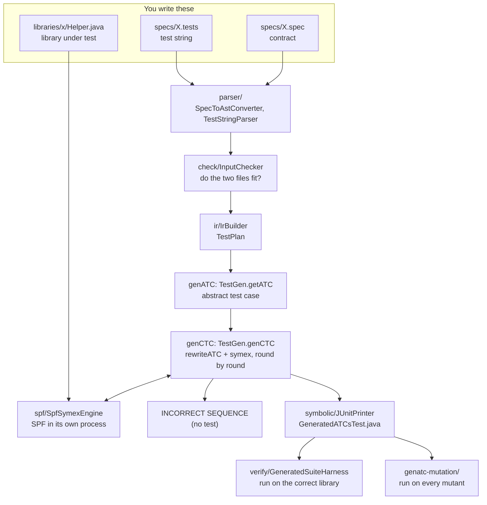

# How TestGen works, end to end

You write a **contract** (`.spec`) and a **test string** (`.tests`) for a Java library. TestGen turns them into one JUnit test for that library. It never reads the library's code: it only calls the library, and only with concrete values. To measure how good the tests are, we plant bugs in copies of the library (mutants) and check whether the tests catch them.

This document follows one run from the two input files to the JUnit test and the mutation score, and names the file responsible at each step. Source paths are under `pl-platform-testing/src/main/java/in/ac/iiitb/plproject/` unless they say otherwise.

---

## The whole flow at a glance



---

## The inputs: three files

| File | What it holds |
| --- | --- |
| `specs/X.spec` | A `state` block with the library's state variables and their types, then one `spec` block per operation with its `signature`, `requires` (precondition) and `ensures` (postcondition). `\old(v)` is the value before the call, and `\result` is the returned value. |
| `specs/X.tests` | One or more `test` blocks, each with a `sequence:` of operation names, for example `push -> push -> pop -> peek`. The test string holds no values: TestGen chooses every argument. An old `inputs { }` block is ignored, with a warning. |
| `libraries/x/Helper.java` | The library under test: static state fields with the same names as the `state` block, one static method per operation, and `reset()`. `orderservice` is a façade (`Helper`) over three classes. |

`atc/LibraryRegistry.java` lists the 14 libraries and maps each key (`stack`, `queue`, …) to its three files and its output folder, `pl-platform-testing/outputs/<key>/`.

---

## The pipeline, step by step

### The entry point: `atc/GenatcMain.java`

`main` takes library keys (none = all 14). For each library, `generate` runs the steps below and `runOne` checks the result on the correct library. The mutation runners call `generate` directly.

### 1. Reading the files: `parser/`

| File | Job |
| --- | --- |
| `SpecToAstConverter.java`, `JmlSpecParser.java`, `PostconditionVisitor.java` | Turn `.spec` text into a `JmlSpecAst`: the state variables, and per operation its signature and its conditions as expression trees. |
| `TestStringParser.java` | Turns `.tests` text into one `TestStringAst` per `test` block. |

### 2. Checking the inputs: `check/InputChecker.java`

Checks that the contract and the test string fit together. For example, every operation in the test string must exist, and every name in a condition must be a parameter, `\result`, a state variable or `\old(v)`. Errors point at the line that caused them and stop the run as `INPUT_ERROR`. It does not check whether preconditions hold, because that depends on the library's state and is found out by genCTC.

### 3. The internal model: `ir/IrBuilder.java` → `ir/TestPlan`

One `TestPlan` per test string. It holds one `CallBlock` per call, with its parameters (`ParamSlot`; strings are `ParamKind.STRING_ID`), the old values to save (`Snapshot`) and its pre- and postcondition clauses (`Clause`).

### 4. genATC: `symbolic/TestGen.getATC`

Generates the **abstract test case** (ATC): a list of statements (`symbolic/Stmt`) with the inputs left open. It starts with `reset`, then has one block per call:

```
old0_size := Helper.size          // save what \old(size) needs
c0_elem   := input<String>()      // an input, value not chosen yet
assume(c0_elem != null)           // the precondition
push(c0_elem)                     // the real call
assert(Helper.size == old0_size + 1)   // one assert per postcondition clause
```

A clause that only names the result (`\result == poppedElem`) is not an assert, because it can never fail.

### 5. genCTC: `symbolic/TestGen.genCTC`

Turns the ATC into the **concrete test case** (CTC), round by round:

```
genCTC(t, L, σ):
    if t has no input left: return t
    t' = rewriteATC(t, L)     // put the values found last round into the inputs, in order
    L' = symex(t', σ)         // run the ready part on SPF and solve for the next inputs
    if L' = ⊥: reject t       // INCORRECT SEQUENCE
    else: return genCTC(t', L', σ)
```

`symex` goes through the statements in order and stops at the first call that is **not ready**. A call is ready only when all its arguments are concrete (`TestGen.isReady`).
- Inputs become symbolic variables.
- Assumes are added to the path constraint.
- Ready calls run on the real library with concrete arguments.
- Asserts are **not** solved. They are only checked in the final JUnit test, so the solver cannot choose inputs that make the library look correct.

A value no condition constrains gets a small free value: 7, 9, 11, ….

### 6. Each symex round on SPF: `spf/`

`spf/SpfSymexEngine.solve` runs one round:

1. `symbolic/SymbolicDriverPrinter.java` writes a small Java driver for the ready part of the test.
   - Known inputs become literals.
   - New inputs become `Debug.makeSymbolicInteger(...)`.
   - Each assume becomes `Verify.ignoreIf(!cond)`.
   - Ready calls go to the real `Helper`.
2. `symbolic/IntegerModel.java` keeps everything in integers the solver understands.
   - A `String` input is an integer id plus a null flag, written in the test as `"s" + id`.
   - A membership test on a symbolic key (`contains`, `containsKey`, `M.get(k)`) becomes equalities over the collection's concrete contents.
   - A string operation on a symbolic string (`length`, `charAt`, …) stops generation as `UNSUPPORTED`.
3. The engine compiles the driver with the library, writes `run.jpf` (settings in `spf/SpfConfig.java`, SPF location from `spf/SpfHome.java`) and runs SPF as a **separate process**.
4. Two listeners run inside SPF:
   - `spf/listener/PathVectorListener.java` stops at the first solved path and writes the values as JSON lines. If no path gets through, it records the assume that blocked every path.
   - `spf/listener/BlackBoxGuard.java` stops the run as `BLACK_BOX_VIOLATION` if a symbolic value ever reaches library code.
5. `spf/PathVectorReader.java` reads the JSON back into a `symbolic/Solution`: the next values, ⊥, or an error (`SOLVER_ERROR`, `TIMEOUT`, `LIBRARY_EXCEPTION`, …).

Each round's files are kept in `outputs/<key>/spf-work/`.

### 7. Writing the test: `symbolic/JUnitPrinter.java`

Every accepted test string becomes one `@Test(timeout = 2000)` method:
- each input becomes a fixed value (`String c0_elem = "s7";`);
- each assume becomes `assertTrue("PRE ...")`;
- each call goes to `Helper`;
- each assert becomes `assertTrue("POST ...")`.

When a test fails, the message names the exact contract clause. The final test does not need SPF.

### 8. Checking it on the correct library: `verify/GeneratedSuiteHarness.java`

`GenatcMain.runOne` copies the library next to the test, then compiles and runs it with JUnit 4 (found by `verify/JunitJars.java`).

---

## What comes out

In `pl-platform-testing/outputs/<key>/` (regenerated on every run; don't edit):

| File | What it is |
| --- | --- |
| `ATC.txt` | The trace: the ATC, `t'` and the solved values for every genCTC round, and the final CTC. For a rejected test string, the round where it stopped and why. |
| `in/ac/iiitb/plproject/atc/generated/GeneratedATCsTest.java` | The JUnit test, one `@Test` per accepted test string. |
| `spf-work/` | Each round's SPF driver, `run.jpf`, the listener's JSON and `blackbox.txt`. |

`pl-platform-testing/golden/<key>/` keeps reviewed copies of `ATC.txt` and `GeneratedATCsTest.java`. `verify-generated.sh` compares against them, so any change in TestGen's output is noticed.

---

## Checking that the output is right

| Check | What it does |
| --- | --- |
| `./verify-generated.sh` | Regenerates all 14 libraries and fails unless each one is `GENERATED`, its JUnit test passes on the correct library, the black-box guard never fired, and the output matches the golden copy. `--update-golden` accepts the current output as the new golden copy. |
| `mvn -o test` (in `pl-platform-testing`) | Unit tests in `GeneratorPipelineTest.java`, including one that fails if the old literal pool comes back. |

---

## Measuring the tests: mutation testing (`genatc-mutation/`)

The test for each library is generated **once**, on the correct library. The same test is then run unchanged against each mutant. A mutant is **killed** if a PRE or POST check fails, the library throws, or the test times out. Otherwise it **survives**. Score = killed ÷ (killed + survived).

| File (under `genatc-mutation/src/main/java/.../mutation/`) | Job |
| --- | --- |
| `MutationOperator.java` | The 17 mutation operators, based on Mothra. Every mutant names one. |
| `MutantSetParser.java`, `Mutant.java` | Read a `.mutants` file and apply one fault to a copy of the library. |
| `TestCache.java` | Generates and compiles each library's test once, and runs it against a compiled library build. |
| `MutantTestMain.java` | Runs the JUnit test in a separate JVM and reports PASS or the failing check. |
| `MutationRunner.java` | Runs the hand-written mutants in `genatc-mutation/mutations/*.mutants` (137 in total) and compares each result with its declared `expect: killed / survives`. |
| `OperatorMutantGenerator.java` | Applies every operator to every line of a library that admits one (1434 mutants in total). |
| `TestStringGenerator.java` | Builds a family of 260 test strings per library. |
| `GeneratedSuiteRunner.java` | Three phases. **Phase 1**: generate a test from each of the 260 test strings on the correct library. **Phase 2**: run the checked-in test against every generated mutant. **Phase 3**: run the survivors against the passing family tests. |

Results are written to `genatc-mutation/operator-suites/` (`results/`, `teststrings/`, `SUMMARY.txt`). A surviving mutant is useful information: it names behaviour the contract and test string do not pin down. See `MUTATION_TESTING.md` and `operator.md`.

---

## Repository layout

| Path | What it is |
| --- | --- |
| `specs/` | `.spec` and `.tests` for the 14 libraries |
| `libraries/` | The 14 libraries under test, one folder per key |
| `pl-platform-testing/` | TestGen itself (Maven module): source, unit tests, `golden/`, `outputs/` |
| `genatc-mutation/` | The mutation testing module, the hand-written `mutations/`, the generated `operator-suites/`, and the two run scripts |
| `scripts/setup-spf.sh` | Builds jpf-core and jpf-symbc at pinned commits and installs them for Maven |
| `verify-generated.sh` | The end-to-end check against the golden copies |
| `spf.txt` | Every problem met with SPF in this project, and how it was solved |

---

## The fourteen libraries

| Key | Checked-in test string | What it exercises |
| --- | --- | --- |
| `stack` | `push → push → pop → peek` | Basic state (`size`, `top`) and an impossible order (`push → pop → pop`) |
| `queue` | `enqueue → enqueue → dequeue → front → isEmpty` | FIFO order through a derived field, and a boolean result |
| `mathlib` | `abs → gcd → power → factorial` | No order constraints; each answer is checked by a property, not an exact value |
| `arraylib` | `set → set → get → sum → indexOf` | Integer inputs and state indexed as `A[index]` |
| `linkedlist` | `addFirst → addLast → removeFirst → indexOf` | Both ends of one structure |
| `heap` | `insert → insert → insert → peekMin → extractMin` | A value named before the call (`\old(minValue)`) and after |
| `set` | `add → add → contains → remove` | String ids and set membership |
| `hashmap` | `put → put → getOldValue → remove` | String keys, map membership and a nullable result |
| `bst` | `insert → insert → insert → contains → min → delete` | Integer keys whose membership is expanded over the concrete keys |
| `graph` | `addVertex → addVertex → addEdge → degree → hasEdge` | Two parameters against a map of sets |
| `lrucache` | `put → put → put → get → restore` | A key that must not be in the cache |
| `taskqueue` | `submit → getResult → cancelTask` | An id that only exists after `submit` runs, solved against the real `Tasks` map |
| `ticketservice` | `numSeatsAvailable → findAndHoldSeats → reserveSeats → numSeatsAvailable` | A hold id solved against the real `Holds` map |
| `orderservice` | `restock → placeOrder → ship → stockLevel` | One contract over a façade and three collaborating classes, with `M.get(k)` in a precondition |